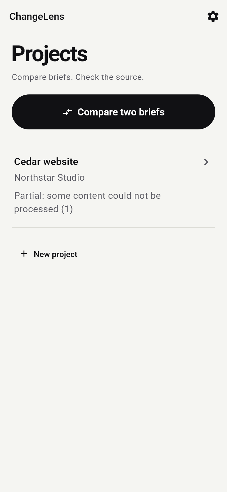
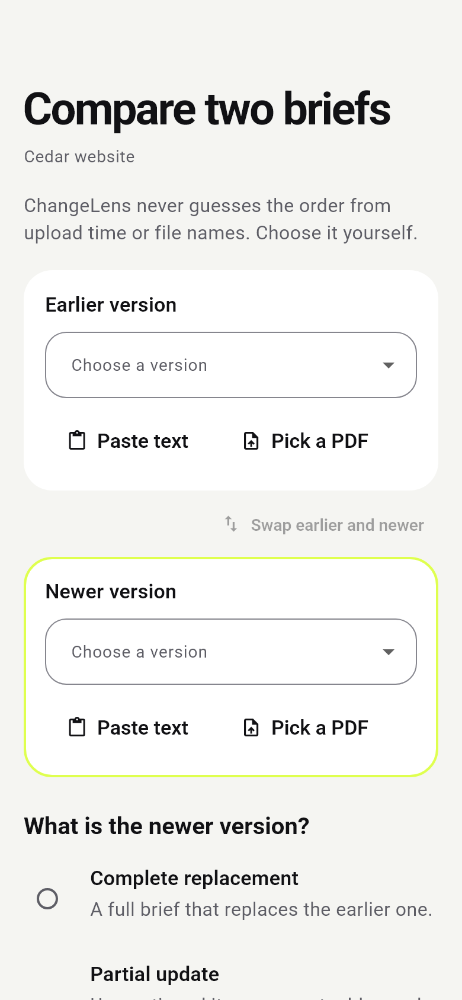
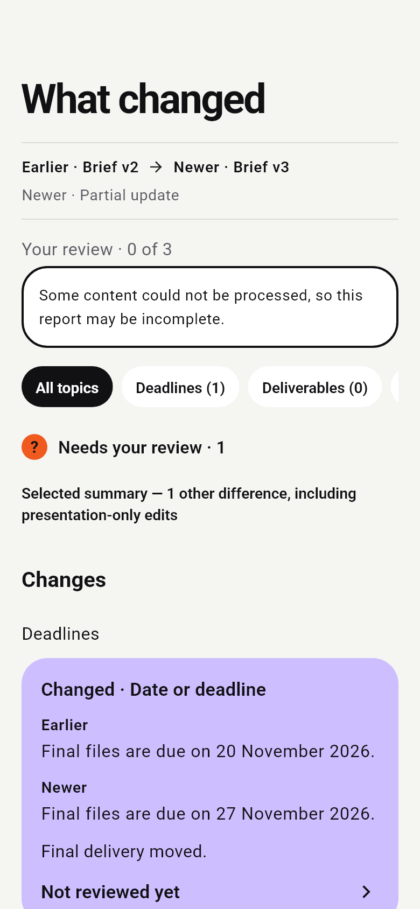
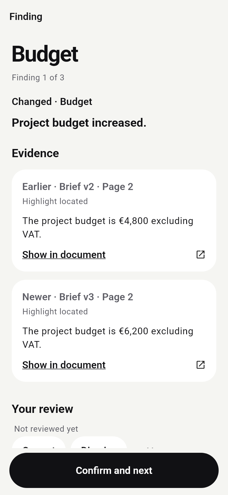
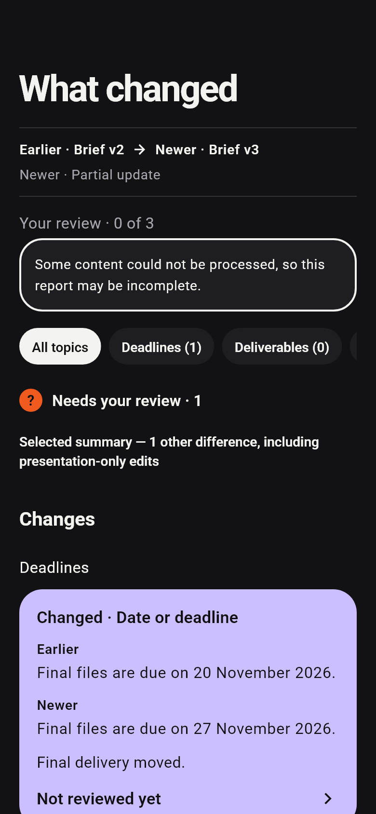
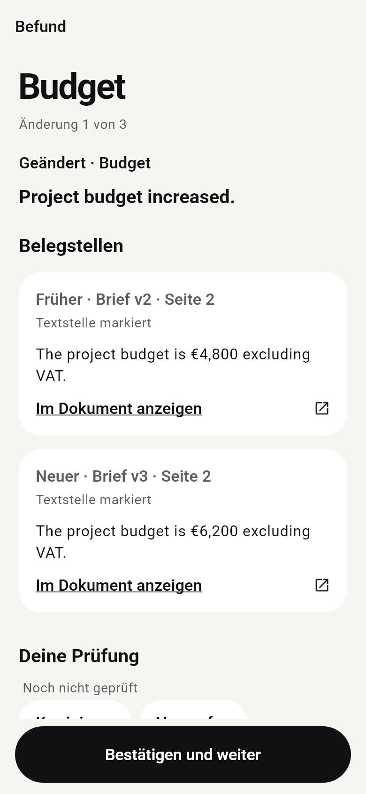

# ChangeLens

**What changed since the last version of the brief, and which changes matter?**

ChangeLens compares two versions of a client brief, pasted as text or picked as a PDF, and reports the changes in deadlines, deliverables, responsibilities, approval wording and budget. Each finding comes with the quoted source passage behind it. It is built for web and design freelancers and small studios who handle revised briefs and need to catch a changed requirement before they deliver the wrong thing.

> **Status:** a hobby project in active development, intended to become a paid product. It is not public. The backend runs locally with a single development token, and only synthetic documents are used. The app is not in the App Store or on Google Play.

<p align="center">
  
  
  
  
</p>

## How it works

1. **You set the context.** Pick the earlier and the newer version yourself and say whether the newer one is a complete replacement, a partial update, or unknown. Nothing is preselected, and the order never comes from upload time or file names.
2. **The backend compares facts.** It parses both inputs, extracts facts, aligns and compares them, and verifies every quotation against its source before reporting.
3. **You review the evidence.** Findings are grouped by topic. Uncertain ones stay in their own *Needs your review* group, whatever topic filter is on. Every finding opens on its quoted passages; a PDF opens with the passage highlighted, or falls back to the parsed text with a visible warning.
4. **Review is not approval.** Confirming, correcting or dismissing a finding is your own review. A client's approval is a separate record labelled *Client approval recorded (not verified by ChangeLens)*.

What ChangeLens deliberately does not do:

- It does not treat silence as a change. Something a partial update does not mention is neither removed nor reconfirmed.
- It does not invent quotes, scores or an "all clear". A selected summary always links to every other difference, including text no finding explains.
- It keeps no document content on the device and none in logs or analytics.

<p align="center">
  
  
</p>

The app follows the system theme and ships in English and German.

## Repository

| Path | What it holds |
| --- | --- |
| [`app/`](app/README.md) | Flutter app for iOS and Android (portrait phones in v1) |
| [`backend/`](backend/README.md) | FastAPI `api` and `worker`, Postgres job queue, S3-compatible storage, the comparison pipeline |
| [`docs/`](docs/) | Product decision, MVP spec, technical design, backlog, decision log, ADRs and the [SOP](docs/SOP.md) |
| [`PRODUCT.md`](PRODUCT.md) · [`DESIGN.md`](DESIGN.md) | Product context and the implemented Calm Bold design system |
| `scripts/`, `evidence/` | CI, release and evaluation scripts, and recorded check output |
| `poc/` | The D-15 proof of concept |

## Stack

- **App:** Flutter (Material 3 themed with Calm Bold), Roboto bundled, `pdfrx` for PDF evidence, ARB localisation (en, de).
- **Backend:** Python, FastAPI, Postgres 16, MinIO for local object storage, a deterministic fake LLM by default and an IONOS-hosted model for evaluation runs.
- **Auth (in progress):** self-hosted Logto replacing the development token (I-8, D-8).

## Run it locally

You need Docker Desktop, Python and Flutter.

1. Start Postgres and MinIO, install the backend and run the API and the worker: [backend/README.md](backend/README.md) §1–3.
2. Run the app on a device or emulator and enter the API address and dev token under **Developer settings**: [app/README.md](app/README.md).

Checks:

```powershell
cd app
flutter analyze
flutter test
```

```powershell
cd backend
.venv\Scripts\python -m pytest tests/unit -q
```

## Roadmap

Built: projects and immutable versions, text and PDF import, one-screen compare, topic-grouped reports, finding review with corrections and history, the separate client-approval record, PDF evidence with a text fallback, 30-day retention after last use, and the German locale.

Planned for v1: public sign-in with account linking and in-app account deletion, screenshot and share-sheet import (gated on measured passage placement), allowances and subscriptions. Push notifications, share links and teams come later. The [backlog](docs/05-backlog.md) has the details.

---

*Screenshots show the synthetic "Cedar website" scenario used by the app's tests, rendered at 390 × 844.*
